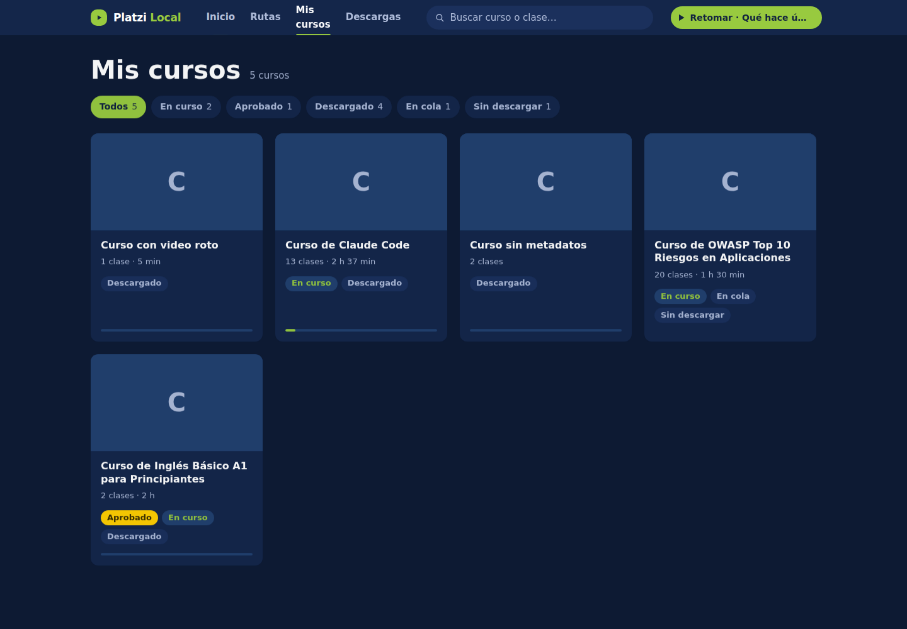
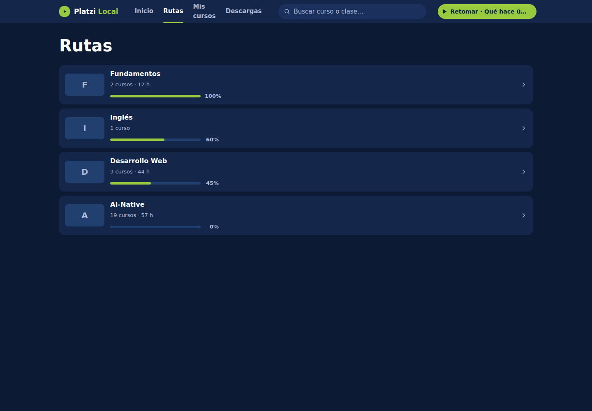
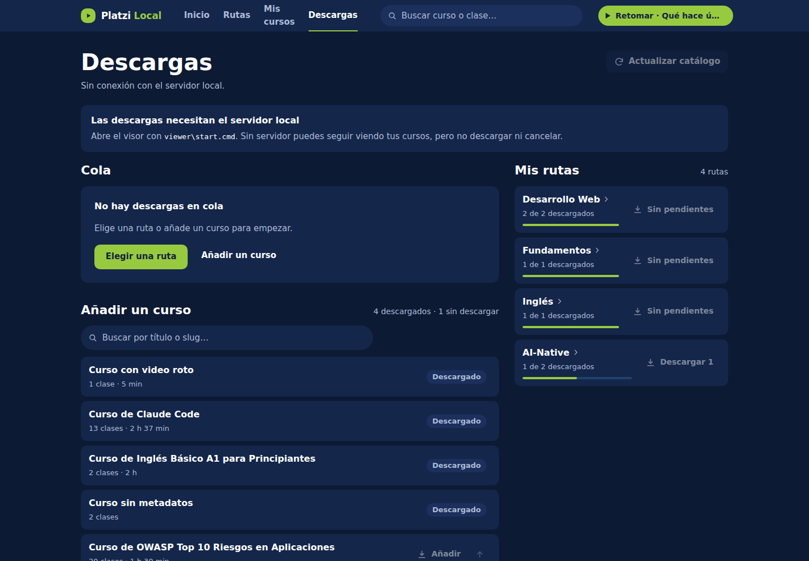

# Platzi Local

Visor local para gestionar descargas de tu cuenta de Platzi y estudiar sin conexión los cursos descargados.

## Empezar

Necesitas Windows, Python 3.9 o superior, ffmpeg y el CLI de Platzi.

1. Instala el CLI: `pip install -U platzi`.
2. Inicia sesión con tu cuenta: `platzi login`.
3. Ejecuta `setup.cmd` y sigue las indicaciones para completar la configuración y abrir el visor.

El visor se abre en el navegador. Para iniciarlo más adelante, ejecuta `viewer\start.cmd`.

## Capturas del visor

Estas capturas se generaron con el visor de pruebas y datos de demostración; no representan una cuenta real.

### Inicio

### Explorar rutas

### Descargas

## Descargar y explorar

- En **Descargas**, añade cursos o rutas a la cola y controla las descargas.
- En **Explorar**, busca cursos de tu biblioteca y del catálogo público. Las novedades públicas requieren internet.
- Para importar una ruta compartida, entra en **Explorar → Descargar una ruta de Platzi**, pega el enlace y pulsa **Leer ruta**.

Los cursos descargados se pueden estudiar sin conexión. Las búsquedas y funciones que consultan Platzi requieren internet y, cuando corresponda, una sesión válida.

## Si necesitas actualizar el catálogo

Después de descargar cursos nuevos, usa **Descargas → Actualizar catálogo**. Si la configuración inicial detecta algo pendiente, `setup.cmd` indica qué falta.
